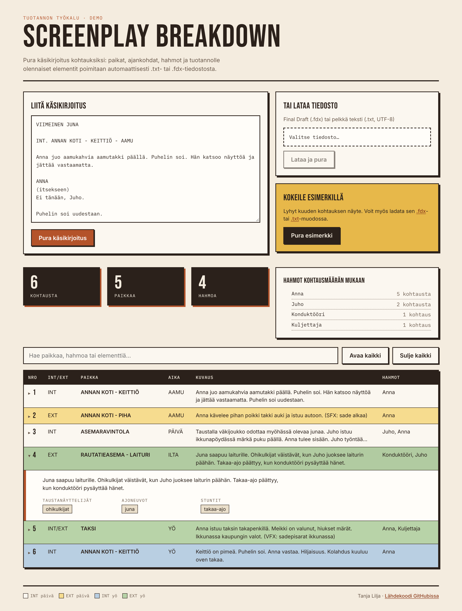

# Screenplay Breakdown

Käsikirjoituksen automaattinen purku kuvaussuunnittelua varten. Sovellus lukee käsikirjoituksen `.txt`- tai Final Draft `.fdx` -muodossa ja purkaa sen kohtauksiksi, joista näkee paikan, ajankohdan, hahmot ja tuotannolle olennaiset elementit.

Projekti syntyi omasta kokemuksesta. Tein viisi vuotta tuotantokoordinaattorina ja tuotantopäällikkönä kansainvälisiä elokuva- ja tv-tuotantoja (mm. *Ivalo*), ja käsikirjoituksen purku kuvausaikataulua varten tehdään edelleen pitkälti käsin.



## Mitä sovellus tekee

- **Kohtaukset ja otsikot.** Tunnistaa INT/EXT-merkinnät, paikan (myös alipaikat, esim. `ANNAN KOTI - KEITTIÖ`) ja ajankohdan.
- **Hahmot.** `.fdx`-tiedostosta luetaan Final Draftin omat Character-kappaleet. Tekstitiedostossa repliikin vetäjät tunnistetaan käsikirjoitusformaatin mukaan isoilla kirjaimilla kirjoitetuista riveistä, ja toimintatekstin nimiä verrataan koko käsikirjoituksen hahmoihin, jotta virkkeen alun sanat ("Kolahdus kuuluu.") eivät päädy hahmoiksi.
- **Tuotantoelementit.** Taustanäyttelijät, puvustus, maski, ajoneuvot, stuntit, äänet sekä `(SFX: …)` ja `(VFX: …)` -merkinnät poimitaan suomeksi ja englanniksi, taivutusmuodot huomioiden.
- **Stripboard-värit.** Kohtaukset väritetään alan perinteisellä koodilla (INT päivä valkoinen, EXT päivä keltainen, INT yö sininen, EXT yö vihreä).
- **Haku ja tilastot.** Haku kaikista kentistä, paikkojen ja hahmojen määrät sekä hahmot kohtausmäärän mukaan.

Poiminta on sääntöpohjaista, ei kielimallia. Rekvisiitta, lavastus ja yleiset huomiot jäävät siksi tyhjiksi, koska niille ei ole luotettavaa tekstisignaalia ilman oikeaa kielenymmärrystä.

## Kokeile

Sovelluksessa on valmiina lyhyt kuuden kohtauksen esimerkkikäsikirjoitus ("Pura esimerkki"). Saman esimerkin voi ladata myös tiedostona, [`.fdx`](frontend/public/esimerkit/viimeinen-juna.fdx) tai [`.txt`](frontend/public/esimerkit/viimeinen-juna.txt).

### Paikallisesti

Vaatii Python 3.10+ ja Node 20+.

```bash
# Backend (http://localhost:8000)
cd backend
python -m venv venv
venv\Scripts\activate          # macOS/Linux: source venv/bin/activate
pip install -r requirements-dev.txt
uvicorn main:app --reload

# Frontend toisessa terminaalissa (http://localhost:5173)
cd frontend
npm install
npm run dev
```

Testit ajetaan `backend`-kansiossa komennolla `pytest`.

### Dockerilla

```bash
docker build -t screenplay-breakdown .
docker run -p 8000:8000 screenplay-breakdown
```

Sovellus aukeaa osoitteeseen http://localhost:8000. Sama image julkaistaan Renderiin `render.yaml`-tiedoston avulla.

## Teknologiat

| | |
|---|---|
| Backend | Python, FastAPI, Pydantic |
| Frontend | React 19, TypeScript, Vite |
| Testit | pytest (39 testiä), TypeScript strict, ESLint |
| Julkaisu | Docker, yksi palvelu (FastAPI tarjoilee myös frontendin) |

## Suunnittelutyö, jota ei toteutettu loppuun

Alkuperäinen tavoite oli monen käyttäjän tuotantotyökalu, jossa käsikirjoituksen purusta edetään stripboardiin ja päivittäisiin call sheeteihin. Tämä osuus on dokumentoitu, mutta sitä ei ole kytketty sovellukseen.

- **Tietokantaskeema.** [`SQL/schema.sql`](SQL/schema.sql) sisältää 21 taulua (script-revisiot väreineen, joustava stripboard, call sheetit jaettuine call-aikoineen, oikeat kuvauspaikat, cast-numerointi ja agenttien yhteystiedot). Skeema on validoitu PostgreSQL-kielioppia vasten.
- **Arkkitehtuuripäätökset.** [`docs/adr/`](docs/adr/) perustelee jokaisen datamallin ratkaisun ja hylätyt vaihtoehdot. UI suunniteltiin Figmassa ja käytiin skeemaa vasten läpi, jolloin löytyi neljä puuttuvaa kenttää (ADR-0004).
- **Autentikointi.** JWT access/refresh-tokenit, bcrypt-salasanat ja niiden 21 testiä toteutettiin, mutta poistettiin päähaarasta, koska tietokantaa ei kytketty. Toteutus löytyy haarasta [`auth-groundwork`](https://github.com/Tinskutansku/screenplay-breakdown-ai/tree/auth-groundwork) ja päätös [ADR-0001](docs/adr/0001-authentication-and-authorization.md):stä.

Miksi projekti päätettiin tähän, on kirjattu [ADR-0005](docs/adr/0005-finish-as-parser-demo.md):een. Kehitysloki löytyy [STATUS.md](STATUS.md):stä.

## Tila

Valmis. Projektia ei kehitetä aktiivisesti eteenpäin.
